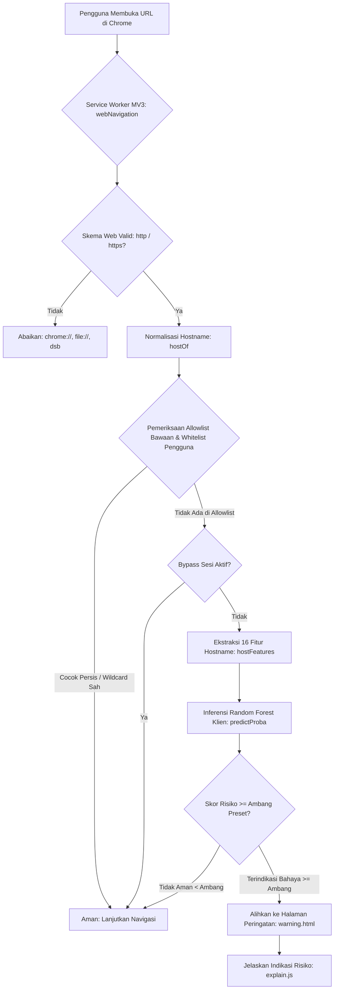

# Dokumen Arsitektur PhishShield

Dokumen ini menjelaskan arsitektur perangkat lunak, modul sistem, dan perbedaan perilaku implementasi teknis antara Python dan JavaScript pada ekstensi Chrome **PhishShield**.

---

## 1. Gambaran Umum Sistem

PhishShield adalah ekstensi Chrome berbasis Manifest V3 yang mengedepankan **privasi mutlak (zero network request)** dan **kemandirian inferensi di sisi klien (in-browser client-side inference)**. Ekstensi ini dirancang untuk mendeteksi indikasi phishing pada tingkat hostname sebelum pengguna berinteraksi lebih jauh dengan situs web berbahaya.

---

## 2. Modul Utama Sistem

1. **`extension/lib/features.js` (Ekstraksi Fitur Hostname)**
   - Bertanggung jawab mengekstrak 16 fitur struktural, leksikal, dan statistik dari hostname murni.
   - Menggunakan konstanta dari `meta.json` (TLD berisiko, hosting gratis, dynamic DNS, kata kunci sensitif, second-level domain).

2. **`extension/lib/rf.js` (Mesin Inferensi Random Forest)**
   - Menjalankan evaluasi 60 pohon keputusan biner yang diekspor dari scikit-learn.
   - Menggunakan `Math.fround` (float32) agar konsisten dengan scikit-learn tree threshold.

3. **`extension/lib/allowlist.js` (Heuristik Allowlist)**
   - Memfilter situs-situs populer sebelum inferensi model dilakukan untuk menekan false positive.
   - Aturan pencocokan ketat: exact match (setelah strip `www.`) dan prefix wildcard domain (`*.`).

4. **`extension/background/service_worker.js` (Pengawas Navigasi MV3)**
   - Menangkap navigasi tingkat frame utama (`frameId === 0`) via `chrome.webNavigation`.
   - Mengalihkan tab ke halaman peringatan saat terdeteksi risiko phishing.

5. **`extension/warning/` & `extension/popup/` (Antarmuka Edukatif)**
   - Menyajikan alasan risiko yang dapat dipahami masyarakat awam melalui `explain.js`.
   - Menyediakan fitur whitelist pengguna dan pilihan preset ambang (Seimbang / Ketat).

6. **`extension/education/` (Modul Edukasi & Pre/Post-Test)**
   - Sarana literasi digital interaktif dengan kuis 10 butir soal dan ekspor data riset anonim ke CSV.

---

## 3. Dokumentasi Perbedaan Perilaku Teknis (Python vs JavaScript)

Pada Fase 1, dilakukan porting logika ekstraksi fitur dari pustaka acuan Python (`urllib.parse`, `math`, `re`) ke JavaScript ES Modules modern (`new URL()`, `Math`, RegExp). Berikut dokumentasi perbedaan perilaku dan solusi penanganannya:

### A. Format Alamat IPv6 (Brackets)
- **Perilaku Python:** `urllib.parse.urlparse("http://[::1]").hostname` secara otomatis membuang tanda kurung siku dan mengembalikan `"::1"`.
- **Perilaku JavaScript:** Objek `new URL("http://[::1]").hostname` mempertahankan kurung siku dan mengembalikan `"[::1]"`.
- **Solusi Penanganan di `features.js`:**
  Fungsi `hostOf(url)` memeriksa apakah hostname diawali `[` dan diakhiri `]`. Jika ya, tanda kurung tersebut dibuang (`h.slice(1, -1)`) agar hasil kalkulasi panjang host dan entropi identik dengan lingkungan Python.

### B. Internationalized Domain Names (IDN) dan Punycode
- **Perilaku Python:** `urllib.parse.urlparse("http://münchen.de").hostname` mengembalikan string Unicode asli `"münchen.de"` (tidak dikonversi ke Punycode kecuali menggunakan pustaka `idna`).
- **Perilaku JavaScript / Peramban:** `new URL("http://münchen.de").hostname` secara otomatis menormalisasi hostname non-ASCII menjadi Punycode (`"xn--mnchen-3ya.de"`).
- **Justifikasi Desain:**
  Perilaku JavaScript ini justru mencerminkan perilaku navigasi jaringan sebenarnya pada peramban Chrome (Chrome selalu mengubah IDN menjadi format Punycode ASCII saat melakukan resolusi DNS). Dengan demikian, fitur `has_punycode` bernilai `1` ketika hostname mengandung prefix `"xn--"`, mendeteksi potensi serangan homograf IDN secara efektif.

### C. Shannon Entropy dan Presisi Floating Point
- **Perilaku Python & JS:**
  Kalkulasi entropi menggunakan rumus:
  $$H(S) = -\sum_{i} P(c_i) \log_2 P(c_i)$$
  Baik Python `math.log2()` maupun JavaScript `Math.log2()` mengimplementasikan floating point 64-bit IEEE 754.
- **Hasil Pengujian:**
  Perbedaan numerik antara Python dan JavaScript berada di bawah $10^{-15}$, jauh lebih presisi dibandingkan batas toleransi yang ditetapkan ($10^{-9}$). Nilai $-0.0$ di JavaScript dicegah dengan memastikan nilai balik `0.0`.

### D. Parsing URL Tanpa Skema dan Penanganan Error
- **Perilaku Python:** `urlparse("example.com")` menganggap `"example.com"` sebagai atribut `path` jika string tidak memiliki skema (`scheme`).
- **Perilaku JavaScript:** Konstruktor `new URL("example.com")` melempar `TypeError: Invalid URL`.
- **Solusi:**
  Kedua implementasi secara seragam memeriksa apakah string mengandung `"://"`. Jika tidak, skema `"http://"` ditambahkan secara otomatis sebelum parsing. Blok `try...catch` disiapkan untuk mengembalikan string kosong `""` jika URL tetap tidak valid (misalnya `"http://[invalid-ipv6"`).
