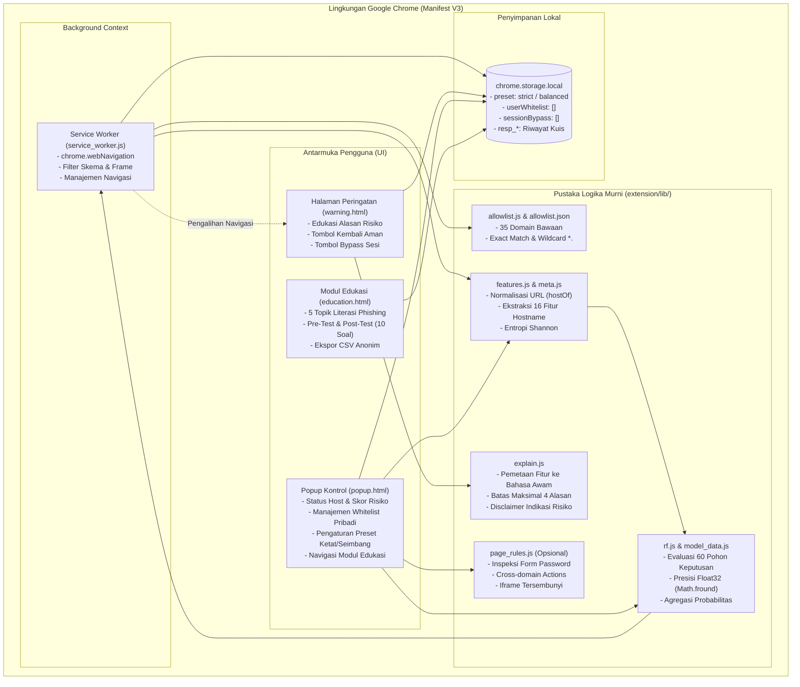
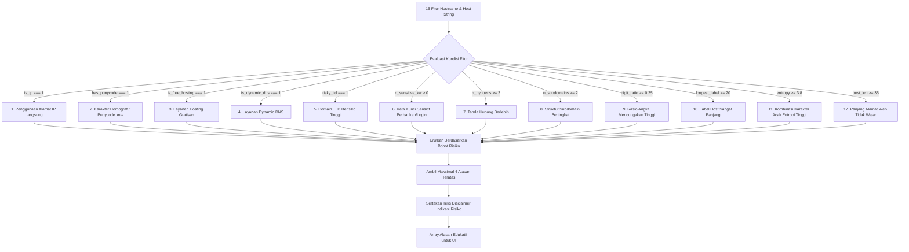

# Dokumen Arsitektur Perangkat Lunak PhishShield

Dokumen ini menjelaskan arsitektur sistem, struktur modul, alur keputusan navigasi, mesin inferensi pembelajaran mesin di sisi klien, pemetaan penjelasan risiko, dan perbedaan perilaku teknis antara pustaka Python dan implementasi JavaScript pada ekstensi Chrome **PhishShield**.

---

## 1. Gambaran Umum Sistem & Komponen Arsitektur

PhishShield dibangun di atas platform **Google Chrome Manifest V3** dengan arsitektur **Zero Network Footprint** dan **In-Browser Machine Learning Inference**. Ekstensi ini berjalan sepenuhnya secara otonom di komputer pengguna tanpa mengirimkan URL atau data apa pun ke server jarak jauh (*remote server*).

### Diagram Blok Komponen Sistem



---

## 2. Alur Keputusan Navigasi (Navigation Decision Flow)

Pencegatan navigasi dilakukan secara real-time pada event `chrome.webNavigation.onBeforeNavigate` sebelum peramban memulai permintaan HTTP ke server target.

```mermaid
flowchart TD
    Start([Pengguna Membuka URL]) --> NavEvent{Event: onBeforeNavigate<br/>frameId === 0?}
    NavEvent -- Tidak (Iframe/Subframe) --> Pass[Abaikan: Lanjutkan Navigasi]
    NavEvent -- Ya (Frame Utama) --> SchemeCheck{Skema Web Valid?<br/>http:// atau https://}
    SchemeCheck -- Tidak (chrome://, file://) --> Pass
    SchemeCheck -- Ya --> HostNorm[Ekstraksi & Normalisasi Hostname<br/>hostOf: hilangkan www. & port]
    
    HostNorm --> CheckAllowlist{Pemeriksaan Allowlist Bawaan<br/>Exact Match / Wildcard *.}
    CheckAllowlist -- Terdaftar --> Pass
    CheckAllowlist -- Tidak Terdaftar --> CheckUserWhitelist{Pemeriksaan Whitelist Pribadi<br/>chrome.storage.local}
    CheckUserWhitelist -- Terdaftar --> Pass
    CheckUserWhitelist -- Tidak Terdaftar --> CheckBypass{Pemeriksaan Bypass Sesi Aktif<br/>sessionBypass []}
    CheckBypass -- Aktif --> Pass
    CheckBypass -- Tidak Aktif --> FeatExtract[Ekstraksi 16 Fitur Hostname<br/>hostFeatures]

    FeatExtract --> RFInfer[Inferensi Random Forest<br/>predictProba]
    RFInfer --> PresetCheck{Skor Probabilitas >= Ambang Batas?<br/>Ketat: 0,7 | Seimbang: 0,5}
    PresetCheck -- Tidak (Skor Aman) --> Pass
    PresetCheck -- Ya (Terindikasi Risiko) --> Redirect[Alihkan ke Halaman Peringatan<br/>warning.html?host=...&score=...]
    Redirect --> WarningView[Render Alasan Edukatif<br/>via explain.js]
```

---

## 3. Mesin Inferensi Random Forest di Sisi Klien (`rf.js`)

Model pembelajaran mesin yang digunakan adalah **Random Forest Classifier** hasil pelatihan scikit-learn yang diekspor ke format JSON (`model_rf.json`) dan dibungkus sebagai ES Module (`model_data.js`).

### Karakteristik Teknis Model:
- **Jumlah Pohon Keputusan**: 60 pohon biner independen.
- **Vektor Masukan**: 16 fitur numerik leksikal hostname (diurutkan secara mutlak sesuai `meta.json`).
- **Penanganan Presisi Floating Point (Float32)**:
  Scikit-learn menyimpan ambang batas pemisahan node (*tree split threshold*) dalam tipe data `float32`. Pada JavaScript, semua angka bertipe `float64`. Untuk menghindari ketidaksesuaian keputusan di titik kritis (*boundary condition*), `rf.js` mengonversi nilai fitur masukan menggunakan `Math.fround()`:
  $$\text{feature\_val} = \text{Math.fround}(x)$$
- **Aturan Penelusuran Pohon**:
  Untuk setiap node pada pohon ke-$i$:
  - Jika $\text{feature\_val} \le \text{threshold}[\text{node}]$, telusuri ke cabang kiri (`left[node]`).
  - Selain itu, telusuri ke cabang kanan (`right[node]`).
  - Node daun ditandai dengan $\text{left}[\text{node}] = -1$.
  - Probabilitas kelas phishing pada node daun diambil dari array `prob[node]`.
- **Agregasi Hasil**:
  Probabilitas akhir adalah rata-rata aritmatika dari probabilitas seluruh 60 pohon:
  $$P(\text{phishing}) = \frac{1}{60} \sum_{i=1}^{60} P_i(\text{phishing})$$

Pengujian terhadap 300 data uji acuan kebenaran (*golden predictions*) membuktikan:
- Tingkat kesesuaian keputusan: **100,00%** (300/300 sampel).
- Selisih probabilitas maksimum: **$9,8133 \times 10^{-8}$** (jauh di bawah batas toleransi $10^{-4}$).
- Waktu inferensi rata-rata: **$0,0058\text{ ms}$ per URL** (~5,8 mikrosekon), memungkinkan evaluasi tanpa latensi yang dirasakan pengguna (*zero perceptible latency*).

---

## 4. Pemetaan Penjelasan Edukatif (`explain.js`)

Salah satu tujuan utama PhishShield adalah edukasi literasi digital. Oleh karena itu, skor numerik diterjemahkan menjadi penjelasan berbasis bahasa awam yang dapat dipahami pengguna non-teknis.



### Prinsip Transparansi & Kejujuran Alasan:
1. **Tidak Ada Alasan Palsu**: Alasan hanya dimunculkan jika didukung oleh nilai fitur yang terpicu. Penjelasan tidak pernah mengklaim hal-hal di luar fitur leksikal hostname (misalnya tidak pernah mengklaim "formulir login palsu terdeteksi" dari hasil model ML).
2. **Disclaimer Eksplisit**: Setiap penjelasan wajib menyertakan pernyataan: *"Peringatan ini merupakan indikasi risiko berdasarkan pola alamat web, bukan kepastian. Selalu periksa kembali keaslian alamat web sebelum memasukkan data sensitif."*

---

## 5. Dokumentasi Perbedaan Perilaku Teknis (Python vs JavaScript)

Pada pengembangan inti, pustaka acuan Python (`urllib.parse`, `math`, `re`) di-porting secara persis ke JavaScript ES Modules modern (`new URL()`, `Math`, RegExp). Berikut dokumentasi perbedaan perilaku teknis beserta solusinya:

### A. Format Alamat IPv6 (Brackets)
- **Perilaku Python:** `urllib.parse.urlparse("http://[::1]").hostname` secara otomatis membuang tanda kurung siku dan mengembalikan `"::1"`.
- **Perilaku JavaScript:** Objek `new URL("http://[::1]").hostname` mempertahankan kurung siku dan mengembalikan `"[::1]"`.
- **Solusi Penanganan di `features.js`:**
  Fungsi `hostOf(url)` memeriksa apakah hostname diawali `[` dan diakhiri `]`. Jika ya, tanda kurung tersebut dibuang (`h.slice(1, -1)`) agar hasil kalkulasi panjang host dan entropi identik dengan lingkungan Python.

### B. Internationalized Domain Names (IDN) dan Punycode
- **Perilaku Python:** `urllib.parse.urlparse("http://münchen.de").hostname` mengembalikan string Unicode asli `"münchen.de"` (tidak dikonversi ke Punycode kecuali menggunakan pustaka `idna`).
- **Perilaku JavaScript / Peramban:** `new URL("http://münchen.de").hostname` secara otomatis menormalisasi hostname non-ASCII menjadi Punycode (`"xn--mnchen-3ya.de"`).
- **Justifikasi Desain:**
  Perilaku JavaScript ini mencerminkan perilaku navigasi jaringan sebenarnya pada peramban Chrome (Chrome selalu mengubah IDN menjadi format Punycode ASCII saat melakukan resolusi DNS). Dengan demikian, fitur `has_punycode` bernilai `1` ketika hostname mengandung prefix `"xn--"`, mendeteksi potensi serangan homograf IDN secara efektif.

### C. Shannon Entropy dan Presisi Floating Point
- **Perilaku Python & JS:**
  Kalkulasi entropi menggunakan rumus:
  $$H(S) = -\sum_{i} P(c_i) \log_2 P(c_i)$$
  Baik Python `math.log2()` maupun JavaScript `Math.log2()` mengimplementasikan floating point 64-bit IEEE 754.
- **Hasil Pengujian:**
  Perbedaan numerik antara Python dan JavaScript berada di bawah $10^{-15}$, jauh lebih presisi dibandingkan batas toleransi yang ditetapkan ($10^{-9}$). Nilai $-0.0$ di JavaScript dicegah dengan memastikan nilai balik `0.0`.

### D. Parsing URL Tanpa Skema dan Penanganan Error
- **Perilaku Python:** `urlparse("example.com")` menganggap `"example.com"` sebagai atribut `path` jika string tidak memiliki skema (`scheme`).
- **Perilaku JavaScript:** Konstruktor `new URL("example.com")` melempar `TypeError: Invalid URL`.
- **Solusi:**
  Kedua implementasi secara seragam memeriksa apakah string mengandung `"://"`. Jika tidak, skema `"http://"` ditambahkan secara otomatis sebelum parsing. Blok `try...catch` disiapkan untuk mengembalikan string kosong `""` jika URL tetap tidak valid (misalnya `"http://[invalid-ipv6"`).

---

## 6. Modul Heuristik Halaman Lokal (`page_rules.js`)

Sebagai fitur pendukung terpisah (Fase 6 Opsional), PhishShield menyediakan inspeksi elemen DOM lokal yang dijalankan secara *on-demand* pada tab aktif:

1. **Input Kata Sandi**: Memeriksa keberadaan `<input type="password">`.
2. **Formulir Lintas Domain**: Memeriksa apakah atribut `action` pada `<form>` mengarah ke domain pihak ketiga yang berbeda dengan hostname tab saat ini.
3. **Iframe Tersembunyi**: Memeriksa elemen `<iframe>` dengan dimensi 0x0 piksel atau `display: none` / `visibility: hidden`.

### Batasan Arsitektural Penting:
Hasil dari `page_rules.js` **BUKAN** merupakan fitur masukan (*feature input*) bagi model Random Forest. Hasil ini ditampilkan secara terpisah di popup dengan label *“Aturan Heuristik Halaman”* agar tidak mencampuradukkan performa model ML dengan aturan berbasis heuristik statis.
